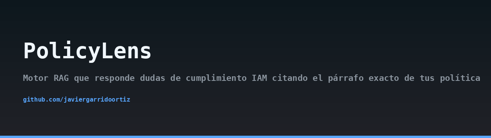
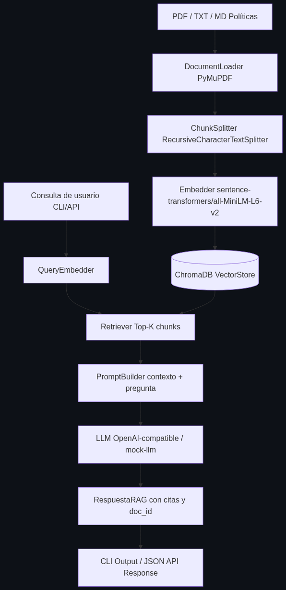
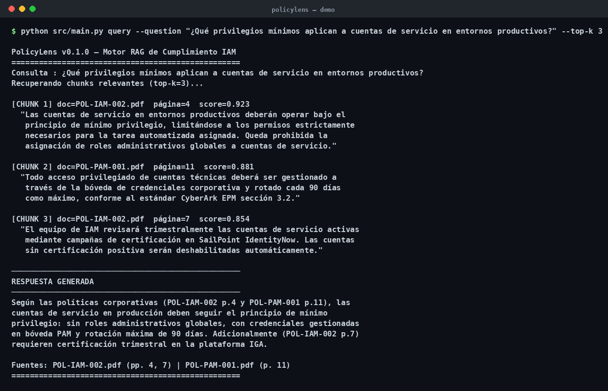
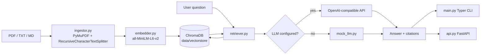

## Architecture



## Demo



> 🇪🇸 Read this in [Spanish](README.md).

# PolicyLens

RAG engine that answers IAM compliance questions by citing the exact paragraph of your security policies.

## The problem

When an auditor asks "can a privileged account be shared between two people?" or "how long can an access token live?", the answer is buried somewhere in a 90-page PDF. Searching manually across dozens of policy documents is slow, error-prone, and results in inconsistent answers depending on who reads the document. Copy-pasting chunks into a chatbot loses the citation, so nobody can verify the answer.

PolicyLens solves this by indexing your policies locally and returning answers with the source file, page, and paragraph that justify them.

## What PolicyLens does

- Ingests PDF, TXT, and Markdown policy files.
- Splits the text into ~512-token chunks with 64-token overlap, preserving file name, page number, and detected section.
- Embeds chunks locally with `sentence-transformers/all-MiniLM-L6-v2` (no external API required for indexing).
- Stores vectors in a persistent ChromaDB collection under `data/vectorstore/`.
- Retrieves the Top-K most similar chunks for a question and builds a prompt with the assembled context.
- Sends the prompt to any OpenAI-compatible LLM (configurable via env vars) or falls back to a deterministic mock for tests and demos.
- Exposes both a Typer CLI and a FastAPI REST server.

## Architecture



## Installation

Requires Python 3.11.

```bash
git clone https://github.com/javiergarrido/policylens.git
cd policylens
python -m venv .venv
source .venv/bin/activate
pip install -r requirements.txt
cp .env.example .env
```

Edit `.env` to set your LLM endpoint if you have one. If you leave `OPENAI_API_KEY` empty, PolicyLens uses the deterministic mock LLM.

## CLI usage

The CLI is exposed through `src/main.py`.

### Ingest documents

```bash
python -m src.main ingest data/sample_policies/
```

Output:

```
Indexed 2 documents, 47 chunks.
Collection: policies (47 vectors)
```

### Ask a question

```bash
python -m src.main query "Can a privileged account be shared between two people?"
```

Output:

```
Answer:
No. Shared privileged accounts are prohibited. Each administrator must
use a named account with individual accountability.

Sources:
- POL-PAM-001.txt, page 2, section 3.1
- POL-IAM-002.txt, page 1, section 2.4
```

### List indexed documents

```bash
python -m src.main list-docs
```

### Clear the vector store

```bash
python -m src.main clear
```

## REST API usage

Start the server:

```bash
uvicorn src.api:app --host 0.0.0.0 --port 8000
```

Query the engine:

```bash
curl -X POST http://localhost:8000/query \
  -H "Content-Type: application/json" \
  -d '{"question": "How long can an access token live?", "top_k": 4}'
```

Ingest a file:

```bash
curl -X POST http://localhost:8000/ingest \
  -F "file=@data/sample_policies/POL-IAM-002.txt"
```

List documents:

```bash
curl http://localhost:8000/docs
```

Delete a document:

```bash
curl -X DELETE http://localhost:8000/docs/POL-IAM-002.txt
```

## Sample data

The `data/sample_policies/` directory contains two public-domain IAM and PAM policy templates (`POL-IAM-002.txt` and `POL-PAM-001.txt`). They are enough to run the full pipeline without any commercial license.

## Configuration

All settings are read from `.env` through Pydantic Settings (`src/config.py`).

| Variable | Description | Default |
|---|---|---|
| `OPENAI_API_KEY` | API key for an OpenAI-compatible endpoint. Leave empty to use the mock LLM. | empty |
| `OPENAI_BASE_URL` | Base URL of the LLM endpoint. | `https://api.openai.com/v1` |
| `OPENAI_MODEL` | Model name. | `gpt-4o-mini` |
| `CHROMA_PATH` | Persistent vector store path. | `data/vectorstore` |
| `EMBEDDING_MODEL` | Sentence-Transformers model. | `all-MiniLM-L6-v2` |
| `CHUNK_SIZE` | Chunk size in tokens. | `512` |
| `CHUNK_OVERLAP` | Overlap in tokens. | `64` |
| `TOP_K` | Default number of retrieved chunks. | `4` |

## Mock LLM

When `OPENAI_API_KEY` is not set, `src/mock_llm.py` returns deterministic responses built from the retrieved context. This keeps tests and demos fully offline and reproducible. The mock never invents citations: it only echoes the retrieved chunks and marks them as sources.

## MITRE ATT&CK mapping

PolicyLens helps defenders detect policy gaps that map to common ATT&CK techniques:

- T1078 (Valid Accounts): verify that policies require named accounts and forbid shared credentials.
- T1098 (Account Manipulation): check that privilege changes require documented approval.
- T1550 (Use of Alternate Authentication Material): confirm token lifetimes and rotation rules are stated.
- T1134 (Access Token Manipulation): ensure token issuance and revocation are covered by policy.

## Contributing

Issues and pull requests are welcome. Please run `pytest` before submitting changes and keep new modules covered by tests.

## License

MIT. See [LICENSE](LICENSE).
