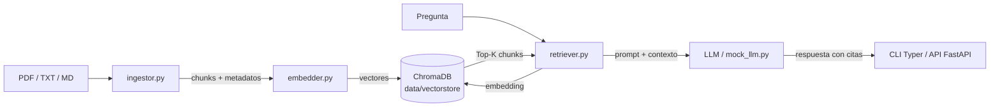

## Arquitectura


## Demo


> 🇬🇧 Read this in [English](README.en.md).

# PolicyLens

[](https://www.python.org/downloads/release/python-3110/)
[](https://fastapi.tiangolo.com/)
[](https://www.langchain.com/)
[](https://www.trychroma.com/)
[](LICENSE)

Motor RAG que responde dudas de cumplimiento IAM citando el párrafo exacto de tus políticas de seguridad.

## El problema

En cualquier organización medianamente grande, las políticas de seguridad IAM y PAM viven en decenas de PDFs repartidos entre wikis, unidades de red y gestores documentales. Cuando un auditor pregunta "¿qué exige nuestra política para la rotación de credenciales privilegiadas?", alguien tiene que abrir el documento correcto, buscar la sección adecuada y transcribir el párrafo literal. Es un proceso lento, manual y propenso a errores: se cita de memoria, se confunde la versión vigente con la anterior, o se responde sin respaldo documental.

El resultado habitual es doble: horas perdidas en cada auditoría y respuestas que no se pueden trazar a una fuente verificable.

## La solución

PolicyLens ingesta tus políticas (PDF, TXT, Markdown), las divide en fragmentos con solapamiento, las vectoriza con un modelo local de Sentence-Transformers y las almacena en ChromaDB. Cuando llega una pregunta, recupera los fragmentos más relevantes por similitud coseno y construye un prompt que obliga al LLM a responder **citando el documento y la página exacta** de donde sale cada afirmación.

Todo el pipeline de embeddings se ejecuta en local: tus políticas no salen de tu máquina salvo en el paso final de generación, y ese paso también puede sustituirse por un mock determinista si no quieres configurar ninguna API externa.

## Arquitectura



Cuatro capas bien separadas:

1. **Ingesta y chunking** (`src/ingestor.py`): PyMuPDF extrae texto y número de página de los PDFs; `RecursiveCharacterTextSplitter` divide en chunks de ~512 tokens con 64 de solapamiento, preservando metadatos de fichero, página y sección.
2. **Indexación vectorial** (`src/embedder.py`): modelo `sentence-transformers/all-MiniLM-L6-v2`, persistencia en `data/vectorstore/`.
3. **Consulta RAG** (`src/retriever.py`): recupera Top-K por similitud coseno, ensambla contexto y consulta al LLM (o al mock).
4. **Interfaz dual** (`src/main.py` CLI con Typer, `src/api.py` con FastAPI).

## Instalación

Requisitos: Python 3.11 y `pip` actualizado.

```bash
git clone https://github.com/javiergarrido/policylens.git
cd policylens
python3.11 -m venv .venv
source .venv/bin/activate
pip install --upgrade pip
pip install -r requirements.txt
cp .env.example .env
```

Edita `.env` si quieres conectar un LLM real. Si lo dejas vacío, PolicyLens arranca en modo mock y funciona igual para demos y tests.

## Uso por CLI

El CLI se expone mediante Typer en `src/main.py`.

**Ingestar un directorio de políticas:**

```bash
python -m src.main ingest data/sample_policies/
```

**Preguntar sobre cumplimiento IAM:**

```bash
python -m src.main query "¿Qué exige la política para la rotación de credenciales privilegiadas?"
```

La respuesta incluye las citas en formato `[fichero p.XX]` para que puedas verificar cada afirmación contra el documento original.

**Listar documentos indexados:**

```bash
python -m src.main list-docs
```

**Vaciar el índice vectorial:**

```bash
python -m src.main clear
```

## Uso por API REST

Arranca el servidor:

```bash
uvicorn src.api:app --host 0.0.0.0 --port 8000
```

Consulta:

```bash
curl -X POST http://localhost:8000/query \
  -H "Content-Type: application/json" \
  -d '{"question": "¿Qué controles aplican a cuentas de servicio?"}'
```

Ingesta de un fichero:

```bash
curl -X POST http://localhost:8000/ingest \
  -H "Content-Type: application/json" \
  -d '{"path": "data/sample_policies/POL-IAM-002.txt"}'
```

Listado y borrado:

```bash
curl http://localhost:8000/docs
curl -X DELETE http://localhost:8000/docs/POL-IAM-002
```

La documentación interactiva está disponible en `http://localhost:8000/docs` (Swagger UI).

## Datos de ejemplo

`data/sample_policies/` incluye dos plantillas de dominio público listas para probar el pipeline sin licencias comerciales:

- `POL-IAM-002.txt`: política de gestión de identidades y accesos, con secciones sobre ciclo de vida de cuentas, MFA y revisión de privilegios.
- `POL-PAM-001.txt`: política de acceso privilegiado, con requisitos de bóveda de credenciales, rotación y grabación de sesiones.

Puedes sustituirlas por tus propias políticas en PDF, TXT o Markdown sin cambiar nada del código.

## Configuración

Todas las variables se leen desde `.env` mediante Pydantic Settings en `src/config.py`.

| Variable | Descripción | Por defecto |
|---|---|---|
| `OPENAI_API_KEY` | Clave del LLM compatible con OpenAI. Vacía activa el mock. | (vacía) |
| `OPENAI_BASE_URL` | Endpoint del LLM (útil para vLLM, Ollama, Azure). | `https://api.openai.com/v1` |
| `CHUNK_SIZE` | Tamaño de chunk en tokens. | `512` |
| `CHUNK_OVERLAP` | Solapamiento entre chunks. | `64` |
| `TOP_K` | Fragmentos recuperados por consulta. | `5` |
| `VECTORSTORE_PATH` | Ruta de persistencia de ChromaDB. | `data/vectorstore` |

## Mock LLM

Si `OPENAI_API_KEY` está vacía, `src/mock_llm.py` entra en acción. Devuelve respuestas deterministas construidas a partir del contexto recuperado, con las mismas citas que produciría un LLM real. Esto permite:

- Ejecutar la suite de tests sin red ni coste.
- Hacer demos reproducibles en entornos aislados.
- Validar el pipeline de recuperación antes de conectar un modelo generativo.

## Casos de uso defensivo (MITRE ATT&CK)

PolicyLens está pensado para equipos defensivos que necesitan responder rápido a preguntas de cumplimiento durante investigaciones o auditorías:

- **T1078 Valid Accounts**: ante una alerta de uso indebido de cuenta válida, pregunta qué controles de MFA, revisión de accesos y caducidad exige la política, citando el párrafo exacto para el informe.
- **T1087 Account Discovery**: verifica qué requisitos de inventario de cuentas y monitorización de enumeración impone tu política, y demuestra el control ante un auditor con la cita literal.

En ambos casos el valor está en la trazabilidad: cada respuesta apunta al documento y página de origen.

## Contribuciones

Las contribuciones son bienvenidas. Abre un issue describiendo el cambio antes de enviar un pull request. Para cambios de código:

1. Crea una rama desde `main`.
2. Añade o actualiza tests en `tests/`.
3. Ejecuta `pytest` y verifica que todo pasa.
4. Envía el PR con una descripción clara del problema y la solución.

## Licencia

MIT. Consulta el fichero [LICENSE](LICENSE) para el texto completo.

Autor: Javier Garrido Ortiz.